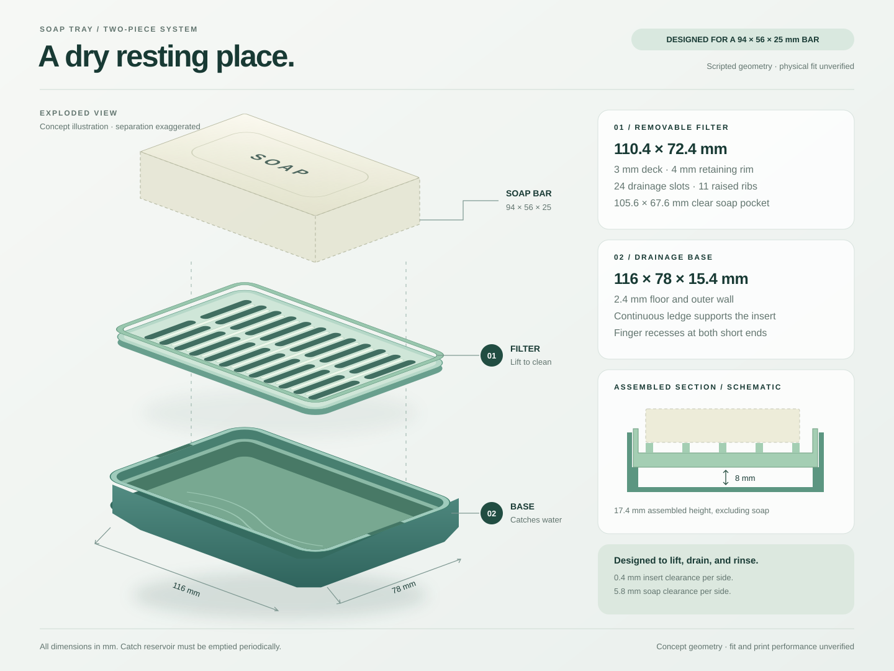

# Soap Tray

A two-part tray for a **94 × 56 × 25 mm** soap bar, with a closed catch tray and removable slotted insert. Revision **v0.1**; dimensions are in **millimetres**.

| Feature | Dimension |
| --- | ---: |
| Assembled envelope, excluding soap | 116 × 78 × 17.4 mm |
| Lower tray | 116 × 78 × 15.4 mm |
| Filter insert | 110.4 × 72.4 × 7 mm |
| Insert clearance | 0.4 mm per side |
| Floor / wall / insert deck | 2.4 / 2.4 / 3 mm |
| Drainage gap | 8 mm |
| Drainage slots | 24 × 4 × 26 mm capsules |

## Editable source

The principal file is [SoapTray.py](source/assemblies/SoapTray/SoapTray.py). Keep its manifest and `model_spec.py` together. The generator also requires [design-inputs.json](design-inputs.json), [catch-tray.json](source/parts/catch-tray.json), and [filter-insert.json](source/parts/filter-insert.json).

Edit the JSON dimensions and regenerate the complete design. Sketch coordinates are fixed; a single native parameter change does not update the complete layout. See [Fusion build instructions](docs/fusion-build.md).

## Exports and status

- [Assembly STEP](exports/v0.1/soap-tray-assembly-v0.1.step): preserve the file's declared units on import.
- [Catch tray STL](exports/v0.1/catch-tray-v0.1-mm.stl) and [filter insert STL](exports/v0.1/filter-insert-v0.1-mm.stl): import as millimetres.

The original Fusion build produced two closed solids and passed its dimension, analytical-volume, and timeline checks. These exports contain the original scripted geometry. Subsequent manual fillets are not captured in this release. The portable source has not yet been re-run in Fusion.

Physical fit, print completion, watertightness, material, and print settings remain unverified. The reservoir must be emptied; it has no drain outlet. Place each STL individually on the build plate because exports use assembly coordinates. Inspect soap-contact edges and test clearance and leakage before use.
